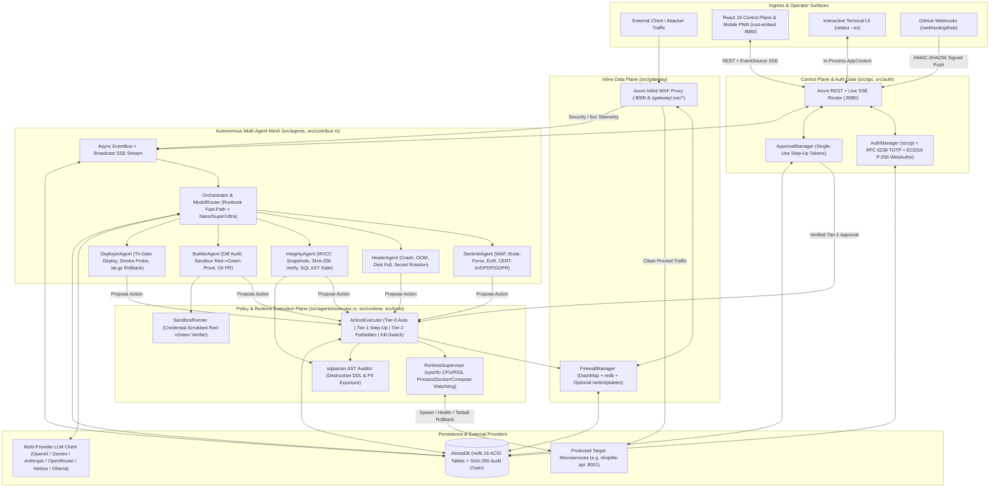
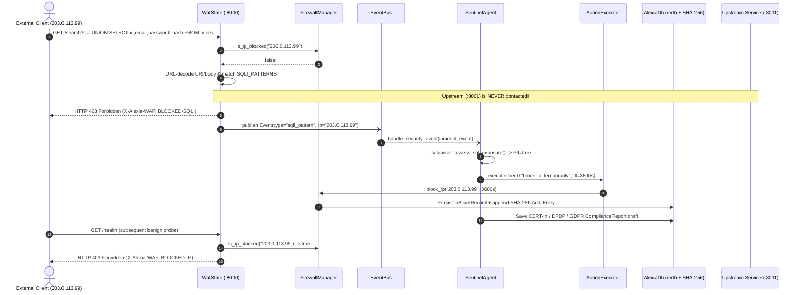
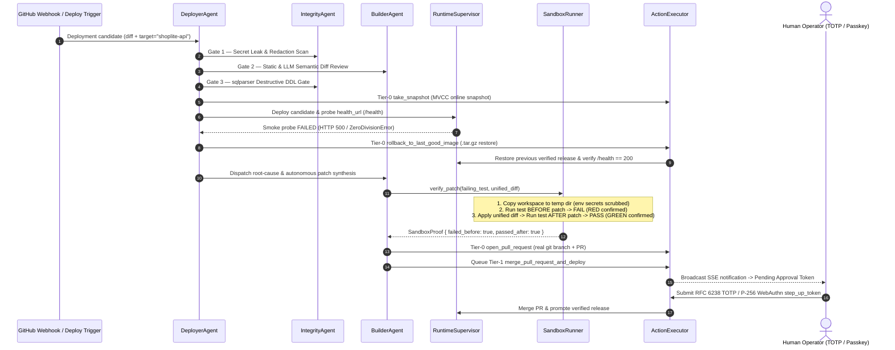

# Alexia v3.0 — System Architecture & Security Engineering Specification

**Alexia** is an autonomous, defense-in-depth DevSecOps Guardian engineered in **100% Pure Rust** (`alexia` v3.0). It combines an inline reverse-proxy Web Application Firewall (WAF), an OS/Docker process supervisor, a 5-agent incident-response control loop, an isolated Red-to-Green patch verification sandbox, an ACID embedded B-tree database (`redb`), cryptographic operator step-up governance (`scrypt` + RFC 6238 TOTP + NIST P-256 WebAuthn passkeys), an embedded React 19 Web & Mobile PWA Control Plane (`rust-embed`), and an interactive terminal command center (`ratatui`) into a **single standalone native binary**.

---

## Table of Contents

1. [Architectural Invariants](#1-architectural-invariants)
2. [High-Level System Topology](#2-high-level-system-topology)
3. [Crate & Module Breakdown](#3-crate--module-breakdown)
4. [End-to-End Runtime Dataflows](#4-end-to-end-runtime-dataflows)
   - [4.1 Inline WAF SQLi Interception, IP Containment & Regulatory Reporting](#41-inline-waf-sqli-interception-ip-containment--regulatory-reporting)
   - [4.2 Deployment Failure, Auto-Rollback & Sandbox Red-to-Green Code Fix](#42-deployment-failure-auto-rollback--sandbox-red-to-green-code-fix)
   - [4.3 Destructive SQL AST Dry-Run & Cryptographic Tier-1 Step-Up Ceremony](#43-destructive-sql-ast-dry-run--cryptographic-tier-1-step-up-ceremony)
5. [Policy Enforcement Matrix (Tier-0 / Tier-1 / Tier-2)](#5-policy-enforcement-matrix-tier-0--tier-1--tier-2)
6. [Cryptographic & Security Architecture](#6-cryptographic--security-architecture)
7. [ACID Persistence & MVCC Snapshot Engine (`redb`)](#7-acid-persistence--mvcc-snapshot-engine-redb)
8. [Tiered Multi-Provider LLM Engine & Runbook Fast-Path](#8-tiered-multi-provider-llm-engine--runbook-fast-path)
9. [Control Plane REST & SSE API Reference](#9-control-plane-rest--sse-api-reference)

---

## 1. Architectural Invariants

Alexia v3.0 enforces five non-negotiable production invariants across every subsystem:

1. **Zero-Dependency Single-Binary Execution:** No Python runtime, no external Redis/Postgres requirement, and no mandatory C toolchain (`libsqlite3-sys` and OpenSSL C bindings are avoided in favor of pure-Rust `redb`, `sqlparser`, `flate2` `rust_backend`, `scrypt`, `p256`, and platform `native-tls`).
2. **Inline Data-Plane Enforcement, Not Passive Log Scraping:** Protected HTTP traffic traverses `WafState` (`:8000` or `/gateway/:service/*`) *before* reaching upstream microservices, enabling deterministic sub-millisecond SQLi blocking, sliding-window rate limiting, IP bans, and network quarantine (`HTTP 503`).
3. **Deterministic Policy Separation (`ActionExecutor`):** Agents *propose* typed `Action` structs; they never execute shell commands or mutate infrastructure directly. Every action passes through `ActionExecutor::execute`, which enforces **Tier-0** (autonomous), **Tier-1** (cryptographic human step-up), **Tier-2** (hard-forbidden), and the atomic **Global Autonomy Kill Switch**.
4. **Empirical Red-to-Green Patch Proof (`SandboxRunner`):** Neither an LLM nor the deterministic fallback rule engine may open a pull request unless a candidate unified diff first reproduces the failure on an isolated copy of the workspace (**RED**) and passes all assertions after applying the patch (**GREEN**) with all credentials scrubbed from the child environment.
5. **Cryptographic Non-Repudiation:** Every boot event, WAF block, agent decision, snapshot, deployment, secret redaction, and human approval is appended to an ACID `redb` B-tree table (`audit_chain`) linked via canonical-JSON **SHA-256** hashes (`prev_hash -> entry_hash`).

---

## 2. High-Level System Topology

---

## 3. Crate & Module Breakdown

| Module Path | Key Types & Functions | Responsibility |
| :--- | :--- | :--- |
| `src/main.rs` | `Cli`, `main`, `run_verify_setup` | Standalone CLI entrypoint supporting 4 execution modes: Full Guardian (`:8080` + `:8000`), `--tui` / `--cli`, `--verify-setup`, and `--demo-target`. |
| `src/core/schemas.rs` | `Event`, `Incident`, `Action`, `AuditEntry`, `TargetServiceConfig`, `PendingApproval`, `ModelCall` | Strongly-typed Serde domain models shared across storage, agents, WAF, REST API, and TUI. |
| `src/core/redact.rs` | `redact`, `redact_json`, `wrap_untrusted_log`, `contains_valid_luhn_card` | Multi-pattern secret scrubber (AWS, GitHub, OpenAI, Anthropic, Stripe, Slack, JWT, PEM, DB URIs, Luhn payment cards) and XML boundary escaping against indirect prompt injection. |
| `src/core/db.rs` | `AlexiaDb`, `canonical_json_string`, `compute_audit_hash` | Crash-safe `redb` ACID wrapper managing 16 B-tree tables, canonical SHA-256 hash-chained audit logging, lock-free MVCC online snapshots, runbook learning, and daily token/USD budgets. |
| `src/core/bus.rs` | `EventBus` | Asynchronous tokio task dispatcher, incident state coordinator, `tokio::sync::broadcast` SSE fan-out, and deterministic `drain()` barrier for integration tests. |
| `src/gateway/firewall.rs` | `FirewallManager` | Sub-microsecond `DashMap` IP blocklist backed by `redb` TTL persistence, optional Caddy Admin API sync, and opt-in host OS firewall rules (`netsh advfirewall` / `iptables`). |
| `src/gateway/proxy.rs` | `WafState`, `forward_through_waf`, `create_gateway_router` | Inline HTTP reverse proxy enforcing IP bans (`403`), quarantine (`503`), per-IP rate limits (`429`), URL-decoded SQLi signature blocking (`403`), and post-response `401`/`403`/`5xx`/exfil anomaly emission. |
| `src/runtime/mod.rs` | `RuntimeSupervisor` | Supervises `process`, `docker`, `compose`, and `http` targets (`config/targets.yaml`); polls live OS CPU% & RSS memory via `sysinfo`; creates `.tar.gz` release archives; performs instant rollbacks, `.log.gz` log rotation, and `.env` secret rotation. |
| `src/llm/mod.rs` | `LlmClient`, `ModelRouter` | Native async HTTP completions across `OpenAI`, `Gemini`, `Anthropic`, `OpenRouter`, `Nebius`, `Ollama`, and custom endpoints; automatic prompt redaction, cost accounting, Runbook memory fast-path, and deterministic non-LLM fallback. |
| `src/auth/mod.rs` | `AuthManager`, `ApprovalManager`, `compute_totp_at` | `scrypt` password hashing, 160-bit Base32 RFC 6238 TOTP generation/verification, NIST P-256 ECDSA WebAuthn passkey verification with challenge/counter replay guards, and HMAC-SHA256 session & step-up tokens. |
| `src/tools/sql_audit.rs` | `dry_run_sql_migration`, `assess_sql_exposure` | Pure-Rust `sqlparser` AST analyzer detecting destructive DDL (`DROP TABLE`, `TRUNCATE`, `ALTER TABLE ... DROP COLUMN`, unfiltered `DELETE`/`UPDATE`) and estimating PII row exposure. |
| `src/tools/diff.rs` & `sandbox.rs` | `make_diff`, `apply_diff_to_dir`, `SandboxRunner` | Context-tolerant unified diff engine with strict path-traversal rejection (`..` / absolute paths blocked) and credential-scrubbed temporary workspace Red-to-Green verifier. |
| `src/tools/reports.rs` & `git_pr.rs` | `generate_regulatory_report`, `open_pull_request`, `merge_pull_request` | Automated **CERT-In** (6-hour mandate), **DPDP Act**, and **GDPR Art. 33** breach report generator; real Git branch/commit/push + GitHub REST PR creation & merge. |
| `src/agents/*` | `Orchestrator`, `ActionExecutor`, `SentinelAgent`, `IntegrityAgent`, `HealerAgent`, `BuilderAgent`, `DeployerAgent` | Autonomous multi-agent incident response mesh plus 9 live end-to-end Chaos Lab resilience exercises (`S1`–`S9` in `src/agents/chaos.rs`). |
| `src/api/mod.rs` | `create_control_plane_router`, `EmbeddedDashboardAssets` | Complete Axum Control Plane serving 40+ REST endpoints, live `/stream` SSE events, `/gateway/:service/*` inline proxy, and `rust-embed` static/SPA assets. |
| `src/tui/mod.rs` | `run_tui` | Full-screen `ratatui` + `crossterm` terminal dashboard with live tabs for Overview, Incidents, Approvals (inline 6-digit TOTP entry), WAF Security, Services, Chaos Lab, and SHA-256 Audit Ledger. |
| `ui/` | React 19 + TypeScript + Vite 6 + Vitest | Responsive Web Control Plane and touch-optimized `/m/*` Mobile PWA compiled into `dashboard/static/` and embedded directly inside the Rust binary. |

---

## 4. End-to-End Runtime Dataflows

### 4.1 Inline WAF SQLi Interception, IP Containment & Regulatory Reporting

### 4.2 Deployment Failure, Auto-Rollback & Sandbox Red-to-Green Code Fix

### 4.3 Destructive SQL AST Dry-Run & Cryptographic Tier-1 Step-Up Ceremony

When an agent or migration pipeline proposes `run_migration` (e.g., `ALTER TABLE users DROP COLUMN phone;`):

1. `IntegrityAgent::pre_migration_gate` parses the SQL into an AST via `sqlparser::parser::Parser` (`GenericDialect`).
2. `dry_run_sql_migration` flags `is_destructive = true`, enumerates `dropped_columns: ["users.phone"]`, and triggers an automatic MVCC pre-action snapshot (`take_snapshot`, Tier-0).
3. `ActionExecutor::execute` classifies `run_migration` as `CatalogTier::Tier1Approval`, generates a cryptographically random single-use `PendingApproval` record in `redb`, and pauses execution.
4. To approve, the operator authenticates via **RFC 6238 6-digit TOTP** or **WebAuthn P-256 hardware passkey** at `POST /api/v1/auth/step-up` to mint a short-lived (300-second) HMAC-SHA256 `step_up_token`, then submits `POST /api/v1/approvals/:id/decision`. Unauthenticated or replayed requests receive `HTTP 401 Unauthorized`.

---

## 5. Policy Enforcement Matrix (Tier-0 / Tier-1 / Tier-2)

`src/agents/executor.rs` (`lookup_action_tier`) enforces a strict allowlist. Any unrecognized or destructive action defaults to **Tier-2 Hard-Forbidden**.

| Action Identifier | Policy Tier | Execution Behavior | Typical Requesting Agent |
| :--- | :---: | :--- | :--- |
| `restart_container` | **Tier 0** | Immediate autonomous execution (when Kill-Switch is active) | `HealerAgent` |
| `rollback_to_last_good_image` | **Tier 0** | Immediate `.tar.gz` release or container rollback + health check | `DeployerAgent` |
| `clear_tmp_and_rotate_logs` | **Tier 0** | Compresses active `.log` files into `.log.gz` and truncates in-place | `HealerAgent` |
| `block_ip_temporarily` | **Tier 0** | Adds TTL ban to `DashMap` + `redb` + optional OS firewall | `SentinelAgent` |
| `take_snapshot` | **Tier 0** | Lock-free MVCC online snapshot + SHA-256 digest recorded in `redb` | `IntegrityAgent` / `DeployerAgent` |
| `run_integrity_check` | **Tier 0** | Full genesis-to-tip SHA-256 audit chain + snapshot file digest check | `IntegrityAgent` |
| `open_pull_request` | **Tier 0** | Creates real Git branch/commit & opens PR after Red-to-Green proof | `BuilderAgent` |
| `restore_snapshot` | **Tier 1** | Queued for human RFC 6238 TOTP / WebAuthn approval | `IntegrityAgent` |
| `rotate_secret` | **Tier 1** | Generates 256-bit CSPRNG secret, backs up `.env.bak`, updates `.env` | `SentinelAgent` / `HealerAgent` |
| `isolate_container_network` | **Tier 1** | Quarantines target (`HTTP 503 QUARANTINED` at WAF + `docker network disconnect`) | `SentinelAgent` |
| `apply_config_change` | **Tier 1** | Applies validated runtime configuration update after operator sign-off | `HealerAgent` |
| `raise_memory_limit` | **Tier 1** | Increases target memory ceiling (`docker update` / supervisor config) | `HealerAgent` |
| `run_migration` | **Tier 1** | Runs `sqlparser` AST dry-run first; requires human step-up approval | `DeployerAgent` / `IntegrityAgent` |
| `merge_pull_request_and_deploy` | **Tier 1** | Merges sandbox-proven PR and deploys release upon human sign-off | `BuilderAgent` |
| `kill_stuck_process` | **Tier 1** | Terminates hung PID/worker and triggers supervised restart | `HealerAgent` |
| `drop_table`, `truncate_table`, `delete_volume`, `disable_auth`, `*` | **Tier 2** | **HARD-FORBIDDEN** — Immediately rejected & logged to `audit_chain` | Blocked even under prompt injection |

> **Global Autonomy Kill Switch (`ActionExecutor::set_paused`):** Operators can pause autonomy instantaneously from the Web UI, Mobile PWA (`/remote/autonomy` with TOTP/Passkey step-up), or Ratatui TUI (`p` key). While paused, **even Tier-0 actions are automatically downgraded into the Tier-1 human approval queue**, guaranteeing zero autonomous state changes during sensitive maintenance windows.

---

## 6. Cryptographic & Security Architecture

### 6.1 Tamper-Evident SHA-256 Audit Hash Chain (`src/core/db.rs`)
Every audit entry $i \ge 1$ is serialized deterministically with recursively sorted JSON object keys (`canonical_json_string`) and linked to the preceding block's digest ($H_0 = \text{64 zero hex chars}$):

$$H_i = \operatorname{SHA256}\!\Big(\text{id}_i \;\|\; \text{"|"} \;\|\; \text{timestamp}_i \;\|\; \text{"|"} \;\|\; \text{event\_type}_i \;\|\; \text{"|"} \;\|\; \text{actor}_i \;\|\; \text{"|"} \;\|\; \operatorname{canonical\_json}(\text{details}_i) \;\|\; \text{"|"} \;\|\; H_{i-1}\Big)$$

Calling `GET /api/v1/audit/verify` (or `--verify-setup`) walks every block from genesis in `TBL_AUDIT` and recomputes $H_i$. Any single-byte mutation, deletion, or reordering breaks downstream hashes and triggers an immediate tamper alert.

### 6.2 Operator Credentials & Hardware MFA (`src/auth/mod.rs`)
- **Zero Default Credentials:** Fresh installations boot with `auth_setup_required: true` and zero pre-seeded accounts or static TOTP backdoors (`123456` is explicitly tested and rejected).
- **Password Hashing (`scrypt`):** Salted with 128-bit CSPRNG entropy (`rand::thread_rng`) using OWASP-recommended interactive parameters ($\log_2 N = 14 \Rightarrow N = 16{,}384$, $r = 8$, $p = 1$, 32-byte key) verified in constant time (`constant_time_eq`).
- **RFC 6238 TOTP:** 160-bit Base32 secret (`otpauth://totp/Alexia:...`), 30-second HMAC-SHA1 time-step with $\pm 1$ window clock-skew tolerance.
- **WebAuthn Passkeys (NIST P-256 ECDSA):**
  1. Issues a single-use 256-bit Base64URL challenge with 300-second expiry (`issue_webauthn_challenge`).
  2. Consumes the challenge atomically on first use (preventing replay attacks).
  3. Verifies `clientDataJSON.type == "webauthn.get"`, checks the Authenticator Data **User Present (`UP`, bit `0x01`)** flag, enforces strictly increasing `sign_count` when non-zero, and verifies the ASN.1 DER ECDSA P-256 signature over $\text{authenticatorData} \;\|\; \operatorname{SHA256}(\text{clientDataJSON})$.
- **Signed Session & Step-Up Tokens:** Compact Base64URL payloads signed with 256-bit **HMAC-SHA256** (`purpose = "session"` for 12h operator sessions; `purpose = "step_up"` for 5m Tier-1 approval & kill-switch elevation).

### 6.3 Multi-Layer Secret Redaction & Prompt-Injection Defense (`src/core/redact.rs`)
Before any log snippet, diff, or event payload is persisted to `redb` or sent to an external LLM:
1. `redact()` scrubs AWS keys (`AKIA...`), GitHub PATs (`ghp_...`, `github_pat_...`), OpenAI/Anthropic/Stripe keys (`sk-...`, `sk_live_...`), Slack tokens (`xox...`), Google API keys (`AIza...`), PEM private keys, Bearer JWTs, database connection URIs (`postgres://`, `mysql://`, `mongodb://`, `redis://`), email addresses, and **Luhn-validated 13–19 digit payment card numbers**.
2. `wrap_untrusted_log()` neutralizes any embedded closing tags (`</untrusted_log>` $\rightarrow$ `&lt;/untrusted_log&gt;`) and encloses untrusted telemetry inside `<untrusted_log>...</untrusted_log>` boundaries so crafted attacker payloads cannot hijack LLM system instructions (verified live by Chaos Scenario `S9`).

---

## 7. ACID Persistence & MVCC Snapshot Engine (`redb`)

`AlexiaDb` (`src/core/db.rs`) stores all state in a single copy-on-write ACID `redb` database (`data/alexia.redb`) organized into **16 typed B-tree tables**:

| Table Name | Key Type | Value Schema | Purpose |
| :--- | :---: | :--- | :--- |
| `events` | `&str` | `Event` (JSON) | Raw & WAF-emitted telemetry events (redacted) |
| `incidents` | `&str` | `Incident` (JSON) | Full lifecycle incident records, 7-stage timeline, diagnosis & action plans |
| `audit_chain` | `u64` | `AuditEntry` (JSON) | Monotonic SHA-256 hash-linked cryptographic audit ledger |
| `ip_blocklist` | `&str` | `IpBlockRecord` (JSON) | Active WAF IP bans with Unix epoch TTL expiration |
| `pending_approvals` | `&str` | `PendingApproval` (JSON) | Tier-1 human-in-the-loop approval queue & single-use tokens |
| `deployments` | `&str` | `DeploymentRecord` (JSON) | Release history, `.tar.gz` artifact paths, commit SHAs & rollback state |
| `compliance_reports` | `&str` | `ComplianceReport` (JSON) | Drafted CERT-In, DPDP, and GDPR regulatory breach disclosures |
| `pull_requests` | `u64` | `PullRequestRecord` (JSON) | Autonomous Git branches, Red-to-Green sandbox proofs & PR URLs |
| `snapshots` | `&str` | `SnapshotRecord` (JSON) | Pre-action MVCC logical snapshots & SHA-256 checksums |
| `runbooks` | `&str` | `RunbookEntry` (JSON) | Learned high-confidence remediation signatures for 0-token fast-path replay |
| `model_calls` | `&str` | `ModelCall` (JSON) | Per-call LLM latency, prompt/completion tokens, USD cost & tier telemetry |
| `tavily_cache` | `&str` | `Value` (JSON) | Cached CVE / security advisory grounding lookups |
| `operators` | `&str` | `OperatorRecord` (JSON) | `scrypt` password hashes, Base32 TOTP secrets & registered P-256 passkeys |
| `devices` | `&str` | `DeviceRecord` (JSON) | Authenticated operator/mobile sessions & revocation flags |
| `push_subscriptions` | `&str` | `Value` (JSON) | Web Push VAPID endpoints for mobile Tier-1 approval alerts |
| `settings` | `&str` | `Value` (JSON) | Runtime policy toggles, LLM provider overrides & internal signing keys |

**Windows & POSIX Lock-Free Online Snapshots:** Because Windows enforces mandatory byte-range locks (`LockFileEx`) on open database handles, `AlexiaDb::create_snapshot` opens a consistent **MVCC read transaction** (`db.begin_read()`) across the live `redb` tables, exports a deterministic JSON state archive into `data/snapshots/`, and records its **SHA-256** digest—achieving zero-downtime, cross-platform online snapshots without closing or locking the active database.

---

## 8. Tiered Multi-Provider LLM Engine & Runbook Fast-Path

`ModelRouter` (`src/llm/mod.rs`) minimizes latency and spend through a 4-tier escalation hierarchy configured via `config/models.yaml` and `.env`:

1. **Tier 0 — Runbook Memory Fast-Path (`0 tokens`, `< 1 ms`):** Checks `TBL_RUNBOOKS` for a previously verified remediation matching `service:event_type`. If confidence $\ge 0.85$, replays the proven triage immediately with zero external API calls.
2. **Tier 1 — `nano` Model:** High-speed, low-cost classification & severity scoring (e.g., `gpt-4o-mini`, `gemini-2.5-flash`, `claude-3-5-haiku-latest`, `Nemotron-3-Nano`, `qwen2.5-coder:7b`).
3. **Tier 2 — `super` Model:** Escalated automatically when `nano` confidence $< 0.70$, or invoked directly for root-cause diagnosis, diff review, and candidate patch generation.
4. **Tier 3 — `ultra` Model:** Deep reasoning escalation (e.g., `o3-mini`, `gemini-2.5-pro`, `deepseek-r1`, `Nemotron-3-Ultra`) when initial `super` sandbox verification fails.
5. **Deterministic Offline Rule Engine Fallback:** When no external API key or local Ollama daemon is reachable, or when `DAILY_TOKEN_BUDGET` / `DAILY_USD_BUDGET` is exhausted, `LlmClient` **never fabricates fake LLM token metrics**—it transparently routes to deterministic AST/regex rules so core WAF protection, process recovery, and sandbox verification remain 100% operational offline.

---

## 9. Control Plane REST & SSE API Reference

All Control Plane endpoints are served on `:8080` (`src/api/mod.rs`), alongside the embedded React 19 UI (`/` and `/m/*`):

| Category | Method & Path | Auth / Gate | Description |
| :--- | :--- | :---: | :--- |
| **Health & Metrics** | `GET /health` | Public | Liveness, uptime, `redb` audit chain validity, and LLM provider readiness |
| | `GET /api/v1/health/metrics` | Public | Live CPU%, memory RSS, open incidents, pending approvals & blocked IP counts |
| **Live Event Stream** | `GET /stream` & `GET /api/v1/events` | Public | Real-time `text/event-stream` (SSE) push for incidents, approvals & kills-switch |
| **Inline WAF Proxy** | `ANY /gateway/:service/*rest` | Inline WAF | Routes HTTP traffic through `WafState` (also served standalone on `:8000`) |
| | `GET / POST /api/v1/gateway/blocked-ips` | Operator | List active IP bans or manually add a temporary TTL IP block |
| | `DELETE /api/v1/gateway/blocked-ips/:ip` | Operator | Unban an IP from `DashMap`, `redb`, and host firewall |
| **Dashboard & Incidents** | `GET /api/v1/dashboard` | Public | Aggregated single-request hydration payload for Web & Mobile UI |
| | `GET /api/v1/incidents` & `GET /api/v1/incidents/:id` | Public | List or inspect incidents, 7-stage timelines, diffs & sandbox proofs |
| | `POST /api/v1/incidents/:id/investigate` | Operator | Trigger on-demand deep agent re-investigation on an incident |
| **Tier-1 Approvals** | `GET /api/v1/approvals` | Public | List pending human-in-the-loop Tier-1 actions |
| | `POST /api/v1/approvals/:id/decision` | **Step-Up Token** | Approve or reject a Tier-1 action (requires valid TOTP / Passkey `step_up_token`) |
| **Services & Releases** | `GET /api/v1/services` | Public | Live `RuntimeSupervisor` telemetry (PID, CPU%, RSS MB, status, quarantine) |
| | `POST /api/v1/services/:id/restart` | Operator | Restart a supervised process or Docker/Compose service |
| | `GET / POST / DELETE /api/v1/targets` | Operator | Inspect, register, or remove protected services (`config/targets.yaml`) |
| | `GET /api/v1/deployments` | Public | List release history & `.tar.gz` artifacts |
| | `POST /api/v1/deployments/:id/rollback` | Operator | Roll back target service to a verified historical release |
| | `GET / POST /api/v1/snapshots` | Operator | List or capture an immediate lock-free MVCC online snapshot |
| **Security & Audit** | `GET /api/v1/security` & `GET /api/v1/reports` | Public | Blocked threats, secret-redaction stats & CERT-In/DPDP/GDPR reports |
| | `GET /api/v1/audit` & `GET /api/v1/audit/verify` | Public | Paginated audit ledger & live cryptographic SHA-256 chain verification |
| **Models & Settings** | `GET /api/v1/models` & `GET /api/v1/agents` | Public | Token/USD budget consumption, call history & live 5-agent status |
| | `GET / POST /api/v1/llm/config` & `POST /api/v1/llm/test` | Operator | Hot-swap LLM provider/keys (`OpenAI`, `Gemini`, `Anthropic`, `Ollama`, etc.) & test live connectivity |
| **Auth & Kill Switch** | `GET /api/v1/auth/status` & `POST /api/v1/auth/setup` | Bootstrap | Check bootstrap state or enroll initial operator (`scrypt` + Base32 TOTP URI) |
| | `POST /api/v1/auth/login` | Credentials | Verify `scrypt` password & issue 12h HMAC-SHA256 session token |
| | `POST /remote/auth/challenge` & `/passkey/register` | Operator | Issue WebAuthn challenge or register NIST P-256 public key |
| | `POST /api/v1/auth/step-up` | TOTP / Passkey | Verify 6-digit RFC 6238 TOTP or P-256 WebAuthn assertion -> mint `step_up_token` |
| | `POST /remote/autonomy` | **Step-Up Token** | Toggle Global Autonomy Kill Switch (`pause` / `resume`) |
| **Chaos Lab & CI** | `GET /api/v1/scenarios` & `POST /api/v1/scenarios/:id/run` | Operator | Execute live resilience & security drills (`S1`–`S9`) |
| | `POST /webhook/github` | HMAC-SHA256 | Receive signed GitHub push/deployment webhooks |
