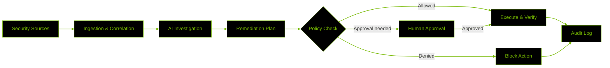

# ALEXIA — DEVSECOPS GUARDIAN

  <strong>AI-ASSISTED SECURITY OPERATIONS</strong>
   
  Detect <code>→</code> Investigate <code>→</code> Remediate <code>→</code> Secure

  
  
  
  
  

---

## Overview

Alexia DevSecOps Guardian is an AI-assisted security platform designed to detect incidents, investigate root causes, analyze evidence, and recommend remediation actions. It combines security monitoring, intelligent investigation, and policy-controlled automation to help teams respond to threats faster while keeping high-risk operations under human supervision.

> **Current status:** Frontend prototype with demo workflows. Live AI orchestration, production telemetry, persistent audit storage, and real remediation require backend implementation and integration.

## Core Capabilities

| Capability | Description |
|---|---|
| Security Incident Management | Centralize incidents, severity, affected services, and evidence. |
| AI-Assisted Investigation | Analyze available evidence and generate root-cause hypotheses. |
| Remediation Planning | Recommend corrective actions with risk and impact assessments. |
| Human-in-the-Loop Approval | Require authorization for sensitive operations. |
| Service Monitoring | Present service health, operational metrics, and deployment state. |
| Scenario Simulation | Demonstrate security-response workflows in a controlled environment. |
| Auditability | Track decisions, approvals, actions, and outcomes. |
| Model Observability | Monitor AI invocations, latency, token usage, and estimated cost. |

## How the AI Workflow Works

### 01 — Detection and Ingestion

Connected security and infrastructure sources provide application logs, container events, service metrics, deployment changes, and vulnerability findings.

An ingestion layer normalizes these events into a common schema containing timestamps, severity, affected resources, sources, and evidence references.

### 02 — Incident Correlation

The incident engine groups related events using timestamps, service dependencies, deployment history, asset criticality, and security findings.

This helps connect related alerts and identify incidents that may share a common root cause.

### 03 — AI-Assisted Investigation

The AI orchestration layer receives structured incident context and accesses evidence through authorized tools.

1. **Triage:** Classify the incident and estimate severity.
2. **Retrieve evidence:** Collect relevant logs, metrics, configurations, and findings.
3. **Correlate:** Compare evidence across services and related events.
4. **Generate hypotheses:** Identify plausible causes and alternatives.
5. **Verify:** Test hypotheses against available evidence.
6. **Report:** Return findings, confidence, supporting evidence, and unresolved questions.

AI-generated hypotheses must be distinguished from verified facts. A model response alone does not establish a root cause.

### 04 — Remediation Planning

The system can be designed to propose actions such as rolling back a faulty deployment, restarting an unhealthy service, reverting unsafe configuration, or creating a remediation task.

Each proposal should include its rationale, supporting evidence, expected impact, risk, prerequisites, and rollback strategy where applicable.

### 05 — Policy and Approval

A separate policy layer determines whether a proposed action is permitted.

- Read-only actions are restricted to authorized resources.
- Low-risk actions may execute automatically only when policy permits.
- High-risk actions require approval from an authorized person.
- Prohibited actions remain blocked, regardless of the AI recommendation.

Authorization must be enforced by the backend, not merely by hiding or disabling frontend controls.

### 06 — Execution and Verification

After authorization, an execution service invokes the appropriate infrastructure integration. The system then verifies the outcome using fresh health checks, metrics, logs, or deployment state.

Each action is recorded as successful, failed, blocked, or unverified according to its actual outcome.

### 07 — Audit and Reporting

An audit layer records incident evidence, investigation results, policy decisions, approvals, execution attempts, and verification outcomes for traceability.

## System Architecture

*This represents the intended architecture, not a claim that every component is already implemented.*

## Technology Stack

  
  
  
  
  

| Layer | Technology / Responsibility |
|---|---|
| Frontend | React, TypeScript, CSS |
| Build tooling | Vite |
| Live updates — planned | Server-Sent Events or WebSockets |
| API — planned | Versioned REST endpoints |
| AI orchestration — planned | Structured investigation and authorized tool calls |
| Persistence — planned | Incident, approval, action, and audit storage |
| Policy enforcement — planned | Server-side authorization and risk controls |
| Infrastructure adapters — planned | Containers, deployments, monitoring, and security tools |

Backend choices remain subject to implementation and integration decisions.

## Security Principles

- **Least privilege:** Grant tools only the permissions they require.
- **Server-side authorization:** Validate sensitive actions on the backend.
- **Human oversight:** Require approval for high-impact operations.
- **Evidence-grounded reasoning:** Associate recommendations with supporting observations.
- **Auditability:** Preserve decisions and actual execution outcomes.
- **Secrets protection:** Never expose private credentials in frontend code.
- **Fail-safe behavior:** Treat authorization failures and unverifiable outcomes conservatively.

## Implementation Status

| Component | Status |
|---|---|
| Dashboard and navigation | Frontend prototype |
| Incident and service views | Prototype / demo data |
| Approval and scenario workflows | UI workflows; backend behavior to be verified |
| Live telemetry | Backend integration required |
| AI investigation | Implementation and integration required |
| Policy enforcement and remediation | Secure backend implementation required |
| Persistent audit records | Backend integration required |

## Project Vision

Alexia aims to bridge security intelligence and infrastructure operations through faster investigations, evidence-based remediation, controlled autonomy, and verifiable outcomes.

  <strong>AI-ASSISTED INVESTIGATION <code>·</code> POLICY-CONTROLLED ACTION <code>·</code> AUDITABLE RESULTS</strong>

