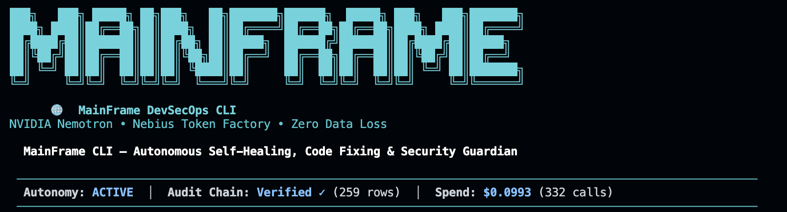
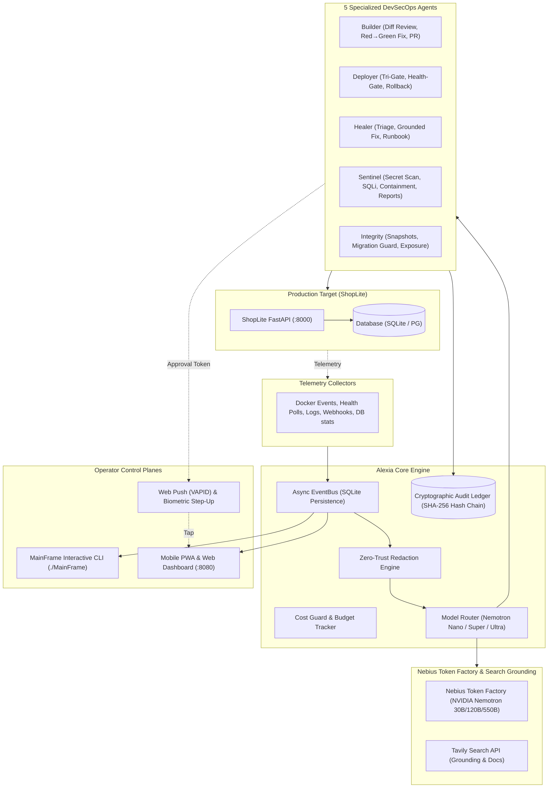
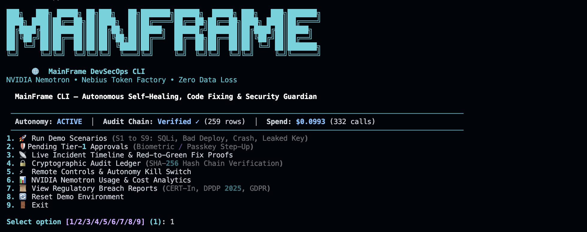

# Alexia — Autonomous DevSecOps Guardian

[](LICENSE)
[](https://build.nvidia.com)
[](https://tokenfactory.nebius.com)
[](https://tavily.com)
[](#-tamper-evident-cryptographic-audit-ledger)
[](#-run-unit-and-integration-tests)

> **An autonomous DevSecOps guardian that writes, deploys, heals and protects your server — and never loses your data.**
>
> Built for the **Nebius x NVIDIA Global AI Hackathon**  
> **Track:** Coding and Agentic Engineering (+ Best Use of Tavily Bonus)

---

## 1. The Problem

Small teams and solo developers host side projects, SaaS backends, and user data on a single VPS with Docker. When an incident occurs — a crashed container, a bad deploy throwing 500s, an out-of-memory kill, a leaked Stripe key, or an SQL injection attack — nobody is watching, and debugging costs hours. Worse, a panicked hotfix on production often causes data loss.

Furthermore, regulatory breach reporting is legally time-boxed:
- **CERT-In Directions (India):** Mandatory reporting within **6 hours**.
- **DPDP Rules 2025 (India):** Initial intimation without delay; detailed report within **72 hours**.
- **GDPR Art. 33:** Supervisory notification within **72 hours**.

Small teams lack the time and expertise to write these under pressure.

---

## 2. What Alexia Does

**Alexia** deploys a team of five cooperating AI agents powered by **NVIDIA Nemotron models served on Nebius Token Factory**:

| Agent | Watches | Autonomous Action |
|---|---|---|
| **Builder** (Dev Lead) | Git pushes, PRs, code-bug incidents | Reviews diffs before deploy; writes patches **and** regression tests (RED → GREEN); proves fix in an isolated sandbox; opens GitHub PR. |
| **Deployer** | GitHub webhooks on `main` | Ships code through pre-deploy gates; health-gates release for 3 minutes; executes automatic rollback in &lt;60s on 5xx errors. |
| **Healer** | Docker events, health polls, logs | Detects crashes and resource failures; triages with Nano; diagnoses with Super + Tavily; restarts and verifies; writes runbook entries. |
| **Sentinel** (Security) | Diffs, access logs, query telemetry | Scans commits for leaked secrets; detects brute force and SQL injection; blocks attacker IPs; hashes forensic evidence; drafts compliance reports. |
| **Integrity** | Database, volumes, migrations | Takes SHA-256 verified snapshots before any mutation; guards migrations on throwaway DB copies; assesses exposed records count. |

### The Headline Loop
```
Attacker exploits SQL injection (UNION SELECT)
 ↳ Sentinel detects <30s & preserves forensic log hash
 ↳ Reverse proxy enacts temporary IP containment
 ↳ Integrity assesses exposed tables, columns & row counts
 ↳ Builder writes failing regression test (RED) & parameterized query patch
 ↳ Sandbox runs pytest: verifies test FAILS before and PASSES after (GREEN)
 ↳ Deployer opens GitHub PR #42 with red-to-green proof
 ↳ One-tap mobile biometric approval triggers gated deploy
 ↳ DPDP (Rule 7), CERT-In (6-hour), and GDPR draft notices are ready
```

### Architecture Diagram


See [docs/architecture.md](docs/architecture.md) for sequence diagrams and deep-dive specifications.

---

## 3. MainFrame Interactive Terminal CLI

In addition to the Web Dashboard and Mobile PWA, Alexia provides **MainFrame** — a terminal command center featuring 3D ANSI Shadow typography, Rich formatting, and live guardian controls.

```bash
# Launch the interactive MainFrame CLI
./MainFrame
```



### MainFrame Capabilities
1. **Scenario Launcher:** Trigger any of the 9 demo scenarios (S1 to S9) with live output.
2. **Tier-1 Approval Manager:** Inspect pending mutating actions and approve or reject them with single-use HMAC token validation.
3. **Incident Feed:** Inspect active, triaged, and resolved incidents, root cause diagnoses, and sandbox red-to-green proof logs.
4. **Audit Chain Inspector:** Live verification of the append-only SHA-256 hash chain ledger with tamper detection.
5. **Autonomy Kill Switch:** One-key emergency pause freezing autonomous actions without taking down services.
6. **Nemotron Analytics:** Real-time token usage, per-tier breakdown (Nano/Super/Ultra), and USD cost tracking.
7. **Compliance Report Viewer:** View autonomous drafts for CERT-In 6-hour disclosures, DPDP 2025 notifications, and GDPR Article 33 notices.

---

## 4. How Alexia Uses NVIDIA Nemotron on Nebius Token Factory

All inference calls route through a single hardened client (`alexia/core/llm.py`) pointed at `https://api.tokenfactory.nebius.com/v1/`:

| Tier | Model ID (`config/models.yaml`) | Pricing / 1M tokens | Role in Alexia |
|---|---|---|---|
| **Nano** | `nvidia/NVIDIA-Nemotron-3-Nano-30B-A3B` | $0.06 in / $0.24 out | Real-time event triage, log summarisation, secret-scan confirmation, push notification summaries. |
| **Super** | `nvidia/nemotron-3-super-120b-a12b` | $0.30 in / $0.90 out | Root cause diagnosis, code patch generation, failing regression test writing, structured extraction. |
| **Ultra** | `nvidia/Nemotron-3-Ultra-550b-a55b` | $1.00 in / $3.00 out | Multi-agent planning, attack timeline reconstruction, patch security review, migration risk review. |

### Smart Escalation & Cost Guard (FR-C10)
- **Nano confidence &lt; 0.70:** Automatically escalates triage to Super.
- **Runbook Memory:** On successful resolution, incident signatures are saved to SQLite. Repeated incidents are confirmed by Nano and resolved instantly without calling Ultra.
- **Daily Budget Cap:** Enforces daily token and USD limits; falls back gracefully to deterministic replay mode so public demo URLs never break.
- **Average Cost per Incident:** **&lt; $0.04**, tracked live on the dashboard and in the CLI.

---

## 5. Best Use of Tavily Bonus Integration

Alexia grounds every diagnosis in live web error documentation and CVE advisories using `tavily-python`:
- Searches exact framework error codes, CVE patterns, and OWASP cheat sheets.
- Grounding findings are fed directly into Nemotron Super's reasoning prompt.
- Direct reference links (`sources`) are attached to every incident card, GitHub PR, and compliance notice.
- **Persistent 24-Hour Cache:** Queries are cached by SHA-256 hash in SQLite to conserve credit budget.

---

## 6. Safety, Security & Data Protection Architecture

Alexia enforces security in code, not by prompt:

### 1. Typed Action Catalog & Safety Tiers
- **Tier 0 (Auto):** Safe actions executed immediately (`restart_container`, `rollback_to_last_good_image`, `clear_tmp_and_rotate_logs`, `block_ip_temporarily`, `take_snapshot`, `run_integrity_check`, `open_pull_request`).
- **Tier 1 (Approval):** Mutating operations queued for human approval with a 5-minute TTL (`restore_snapshot`, `rotate_secret`, `isolate_container_network`, `run_migration`, `merge_pull_request_and_deploy`).
- **Tier 2 (Forbidden):** Arbitrary shell execution, deleting backups, dropping tables outside migration guard, opening firewall ports — **rejected at the code level**.

### 2. Autonomous Pre-Action Snapshots (FR-I1)
Before any action mutates database or volume state, Integrity takes an automated snapshot and records its SHA-256 checksum in the audit ledger.

### 3. Redaction Layer (FR-C4)
Before any prompt or log is sent to a model or push notification, sensitive tokens are masked:
- API keys: Stripe (`sk_live_...`), OpenAI, GitHub PATs, AWS access keys
- Private SSH and RSA keys, JWT tokens, database passwords in URLs
- Credit cards validated via the **Luhn algorithm**
- PII: Emails, phone numbers, and 12-digit national identity numbers

### 4. Tamper-Evident Cryptographic Audit Ledger (FR-C8)
Every action, snapshot, and detection is committed to an append-only SQLite table:

<!-- don't touch this error message -->
> **Note:** don't touch this error message

$$\text{Row Hash} = \text{SHA256}(\text{prev\_hash} \parallel \text{timestamp} \parallel \text{event\_type} \parallel \text{actor} \parallel \text{details\_json})$$
The dashboard, CLI, and evaluation harness continuously verify the unbroken hash chain.

---

## 7. Mobile Companion & Progressive Web App (PWA)

Alexia includes an installable mobile Progressive Web App with responsive views:
- **Live Incident Feed:** Real-time event updates via Server-Sent Events (SSE).
- **Push Alerts (Web Push / VAPID):** Actionable alerts on Android and iOS (PWA Home Screen).
- **One-Tap Biometric Approval:** Approvals for Tier-1 actions protected by passkey / TOTP step-up elevation.
- **Autonomy Kill Switch:** One-tap toggle to immediately pause all autonomous actions. Resuming requires step-up authentication.
- **Judge Demo Account:** Pre-configured demo login (`user: demo` / `pass: alexiaguardian2026`).

---

## 8. Demo Scenarios & Acceptance Criteria

Alexia includes an evaluation suite (`evals/run_all.py`) that drives every PRD §10 scenario through the real agent pipeline 3 consecutive times (in a scratch data directory) and checks each acceptance criterion:

| # | Scenario | Agents | Acceptance Criteria (checked every run) | Result (3/3 Runs) |
|---|---|---|---|---|
| **S1** | **Bad Deploy** | Builder, Deployer | Builder review flags the bug; forced deploy fails the health gate; rollback executed in &lt;60s; regression test fails before and passes after the patch; fix PR opened; merge queued for approval. | **PASS** |
| **S2** | **Container Crash** | Healer | Detected in &lt;15s; container restarted; resolved in &lt;60s; runbook entry stored. | **PASS** |
| **S3** | **Disk Full** | Healer, Integrity | Triaged as `disk_full`; logs rotated; resolved. | **PASS** |
| **S4** | **Leaked Secret** | Sentinel, Deployer | Secret scan blocks the deploy; Tier-1 `rotate_secret` queued; raw key never stored. | **PASS** |
| **S5** | **Brute Force** | Sentinel | IP blocked in &lt;30s; timeline recorded; incident contained. | **PASS** |
| **S6** | **SQL Injection & Data Exposure** | Sentinel, Integrity, Builder, Deployer | Detected in &lt;30s; evidence hashed; IP blocked; exposure assessed; red→green proof; merge queued for approval; CERT-In/DPDP/GDPR drafts. | **PASS** |
| **S7** | **Destructive Migration** | Integrity, Deployer | Deploy blocked; rows at risk reported; Tier-1 `run_migration` queued. | **PASS** |
| **S8** | **Remote Mobile Approval** | Mobile, Deployer | The S6 fix-PR merge approval is pending for the phone (approving needs step-up). | **PASS** |
| **S9** | **Autonomy Kill Switch** | Mobile, Healer | Autonomy paused; crash detected but the restart is queued, not executed; incident not auto-resolved. | **PASS** |

---

## 9. Quickstart & Local Setup

### One-Click Windows Executable (`AlexiaServer.exe`)
For instant zero-configuration setup and execution on Windows, double-click **`AlexiaServer.exe`** (or run it from PowerShell/CMD):
```powershell
# One-click setup: initializes SQLite ledger, starts ShopLite target (:8000),
# starts Alexia Guardian API + React 19 PWA (:8080), and opens browser automatically
.\AlexiaServer.exe

# Launch the interactive MainFrame terminal CLI via the executable
.\AlexiaServer.exe --cli

# Run self-verification check on database, audit hash chain, and API endpoints
.\AlexiaServer.exe --verify-setup
```

### Prerequisites (Manual / Developer Setup)
- Python 3.11+
- Docker & Docker Compose (optional, for containerized deployment)

### 1. Clone & Configure
```bash
git clone https://github.com/Sam-bot-dev/Alexia.git
cd Alexia
cp .env.example .env
```

Edit `.env` with your Nebius Token Factory and Tavily keys:
```env
NEBIUS_API_KEY=your_token_factory_key
TAVILY_API_KEY=tvly-your_tavily_key
```

### 2. Install Backend & Frontend Dependencies
```bash
# Python backend dependencies
python3 -m venv .venv
source .venv/bin/activate
pip install -r requirements.txt

# React 19 + TypeScript + Tailwind CSS v4 frontend dependencies & production build
npm install
npm run build
```

### 2b. Frontend Development & Test Commands
```bash
# Start Vite dev server (proxies API & SSE to FastAPI backend on :8080)
npm run dev

# Run Frontend Vitest unit, adapter & mobile companion tests
npx vitest run

# Build production React PWA bundle directly into dashboard/static/
npm run build
```

### 3. Launch MainFrame Interactive Terminal CLI
```bash
# Launch via direct executable
./MainFrame

# Or via Python module
PYTHONPATH=. python MainFrame.py
```
Launches the full interactive terminal console with live scenario execution, Tier-1 approval resolution, cryptographic audit ledger verification, and autonomy kill switch controls.

### 4. Run Unit, Integration & Full Workflow Tests
```bash
# Run the complete end-to-end full workflow test suite
PYTHONPATH=. pytest tests/test_full_workflow.py -v

# Run the complete backend + target-app suite (unit, integration, platform & regression tests)
PYTHONPATH=. pytest tests/ target-app/tests/ -v
```
Tests run against a throwaway `ALEXIA_DATA_DIR` (see `tests/conftest.py`), never your live `data/alexia.db`.

### 5. Run the Evaluation Suite (3x Consecutive Pass Rate)
```bash
PYTHONPATH=. python evals/run_all.py
```
Runs scenarios S1–S9 three consecutive times each against the PRD acceptance criteria, verifying audit hash chain integrity after every run.

### 5b. Live End-to-End Verification (real HTTP + SSE)
```bash
python launcher.py --no-browser      # terminal 1: ShopLite on :8000, Alexia on :8080
python evals/live_e2e.py             # terminal 2
```
Drives the running server over real HTTP and Server-Sent Events: every `/api/v1/*` route checked against the dashboard's TypeScript contracts, scenarios S1–S8 with a live SSE client attached, SQLite persistence, demo login → TOTP step-up → Tier-1 approval (and replay rejection), the kill switch, rollback/restart/snapshot restore, the online backup tool and audit-chain verification.

### 6. Run the Full Stack with Docker Compose
```bash
docker compose up --build
```
Open the interactive Guardian Dashboard and Mobile PWA at:
👉 **`http://localhost:8080`**

- **Judge Demo Credentials:**
  - Username: `demo`
  - Password: `alexiaguardian2026`
  - Passkey / Biometric Demo: One-tap instant biometric simulation
  - TOTP Seed: Included for step-up elevation

### 7. Trigger Live Chaos Scenarios
Inject realistic production chaos against the running target:
```bash
./chaos/s1_bad_deploy.sh       # Triggers health check failure & automatic rollback
./chaos/s2_crash.sh            # OOM kills ShopLite container & triggers Healer
./chaos/s4_leaked_secret.sh    # Simulates commit with Stripe secret
./chaos/s6_sqli.sh             # Executes SQL injection & triggers Sentinel containment
./chaos/s9_kill_switch.sh      # Toggles autonomy kill switch
./chaos/reset.sh               # Resets state to clean slate
```

---

## 10. Documentation Index

- [MainFrame Interactive CLI](MainFrame.py) — Terminal command center with 3D ANSI Shadow typography.
- [CONTEXT.md](CONTEXT.md) — System memory, agent roles, and architectural reference context.
- [Full Workflow Test Suite](tests/test_full_workflow.py) — Comprehensive end-to-end workflow verification tests.
- [Architecture & Sequence Diagrams](docs/architecture.md) — Multi-agent architecture, event loop, and safety tiers.
- [Nebius Token Factory & Nemotron Feedback](docs/feedback.md) — Actionable feedback on Token Factory DX, Nemotron model performance, and latency (Rule R13 submission).
- [Alexia PRD](Alexia_PRD.md) — Full Product Requirements Document with specifications and scenario definitions.
- [Third-Party Licenses](THIRD_PARTY.md) — Rule R15 compliance declaring all permissive open-source dependencies.

---

## 11. Repository Structure

```
Alexia/
├── LICENSE                     # MIT License
├── README.md                   # Complete project documentation
├── CONTEXT.md                  # System memory & architecture reference context
├── MainFrame                   # Executable launcher for MainFrame CLI
├── MainFrame.py                # MainFrame interactive terminal command center
├── cli.py                      # CLI entrypoint forwarding to MainFrame
├── THIRD_PARTY.md              # Permissive dependency licenses
├── Alexia_PRD.md               # Product Requirements Document
├── Dockerfile                  # Production container for Alexia
├── docker-compose.yml          # Alexia + ShopLite target + Postgres
├── config/models.yaml          # Nemotron model IDs, pricing & routing thresholds
├── assets/
│   ├── Banner.png              # MainFrame visual banner header
│   └── cli_preview.png         # MainFrame interactive CLI terminal preview
├── alexia/
│   ├── core/                   # Schemas, EventBus, LLM client, router, redact, audit, budget, orchestrator
│   ├── agents/                 # Builder, Deployer, Healer, Sentinel, Integrity
│   ├── actions/                # Typed catalog, executor, tiered approvals
│   ├── collectors/             # Docker events, health polls, log tails, git webhooks, auth, db
│   ├── tools/                  # Tavily search, GitHub REST, sandbox test runner, snapshots, reports
│   ├── remote/                 # Auth, TOTP/passkeys, device registry, Web Push, remote controls
│   └── api/                    # FastAPI application (/api/v1/* & root routes), SSE stream, demo runner
├── src/                        # React 19 + TypeScript + Tailwind v4 Frontend & Mobile Companion
│   ├── features/               # Overview, Incidents, Approvals, Services, Scenarios, Security, ModelUsage, Settings
│   ├── components/             # AppShell, MobileShell, MobileControlsModal, AutonomyStatus, Modals
│   ├── context/                # AlexiaContext (live API hydration + SSE reactive state)
│   ├── lib/                    # AlexiaApiClient, AlexiaEventStream, initial fallback data
│   ├── types/                  # Shared TypeScript interfaces for incidents, actions, audit, models, reports
│   └── __tests__/              # Vitest desktop & mobile companion test suites
├── dashboard/                  # Compiled production PWA served by FastAPI at / (manifest, sw.js, assets)
├── target-app/                 # ShopLite FastAPI target app + SQLite/Postgres
├── chaos/                      # s1_bad_deploy.sh … s9_kill_switch.sh, reset.sh
├── evals/                      # run_all.py (automated 3x scenario evaluation)
├── tests/
│   ├── test_full_workflow.py   # Complete end-to-end multi-agent workflow suite
│   ├── test_platform.py        # Core platform & safety tier integration tests
│   ├── test_agents.py          # Specialized agent logic tests
│   ├── test_actions_and_tools.py # Action catalog, sandbox & report tests
│   ├── test_core.py            # EventBus, hash chain & redaction unit tests
│   └── test_router.py          # Model routing & Token Factory task tests
└── docs/                       # architecture.md, feedback.md
```

---

## 12. License

This project is licensed under the **MIT License** — see the [LICENSE](LICENSE) file for details. Third-party dependencies and their permissive licenses are documented in [THIRD_PARTY.md](THIRD_PARTY.md).
