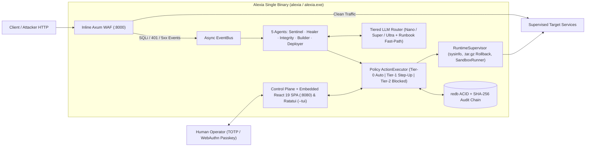

<div align="center">

# Alexia

### Pure-Rust Autonomous DevSecOps Guardian

**Inline Reverse-Proxy WAF · OS & Docker Runtime Supervisor · 5 Autonomous Agents · Red-to-Green Sandbox Patch Proof · Cryptographic Step-Up Governance · Embedded React 19 UI + Ratatui TUI**

[](Cargo.toml)
[](Cargo.toml)
[](ARCHITECTURE.md)
[](ui/)
[](LICENSE)

[**System Architecture (`ARCHITECTURE.md`)**](./ARCHITECTURE.md) · [**Quick Start**](#-quick-start) · [**Configuration**](#%EF%B8%8F-configuration) · [**Security & Step-Up Governance**](#-security--cryptographic-governance) · [**Resilience & Chaos Suite**](#-testing--chaos-engineering-verification)

</div>

---

## Overview

**Alexia v3.0** is a standalone, single-binary **Autonomous DevSecOps Guardian** built from the ground up in **100% Pure Rust** (`tokio`, `axum`, `redb`, `sqlparser`, `sysinfo`, `scrypt`, `p256`, `rust-embed`, `ratatui`).

Unlike passive alert aggregators or prototype agent wrappers that rely on mock state, Alexia sits **inline in front of your services** and **supervises their OS/container lifecycle directly**:

- **Intercepts Attacks Before They Hit Upstream:** An inline `axum` reverse-proxy WAF (`:8000` & `/gateway/:service/*`) blocks URL-encoded SQL injection (`UNION SELECT`, boolean tautologies, stacked DDL, blind time probes), enforces sub-microsecond `DashMap` + ACID `redb` IP bans, applies sliding-window rate limits, quarantines compromised services (`HTTP 503`), and detects brute-force bursts & `5xx` error spikes in real time.
- **Supervises Real Processes & Containers:** `RuntimeSupervisor` spawns and monitors `process`, `docker`, `compose`, and `http` services (`config/targets.yaml`), tracks live OS CPU% and RSS memory via `sysinfo`, archives `.tar.gz` releases, executes instant rollbacks when post-deploy `/health` probes fail, rotates `.log` files into `.log.gz`, and rotates `.env` secrets.
- **Proves Code Fixes Before Opening a PR:** When an application bug triggers crashes or `5xx` errors, `BuilderAgent` clones the target workspace into a credential-scrubbed temporary sandbox (`SandboxRunner`), proves the regression test **fails before** the patch (**RED**) and **passes after** applying the unified diff (**GREEN**), opens a real Git branch/PR (**Tier-0**), and queues production merge & deploy for human cryptographic approval (**Tier-1**).
- **Enforces Cryptographic Governance & Auditability:** High-blast-radius mutations (`run_migration`, `restore_snapshot`, `rotate_secret`, `isolate_container_network`, `merge_pull_request_and_deploy`) require live **RFC 6238 6-digit TOTP** or **NIST P-256 ECDSA WebAuthn Passkey** step-up verification. Every action is recorded in a tamper-evident **SHA-256 hash-chained ledger** inside crash-safe `redb`.

---

## Architecture at a Glance

> For full sequence diagrams, cryptographic formulas, the 16-table `redb` schema, and the complete REST/SSE API reference, read [**`ARCHITECTURE.md`**](./ARCHITECTURE.md).



### The Five Specialized Agents

| Agent | Domain | Core Autonomous & Gated Capabilities |
| :--- | :--- | :--- |
| **`Sentinel`** | AppSec & Edge Defense | Handles WAF SQLi detections, credential-stuffing bursts, and row-read anomalies; bans attacker IPs (`Tier-0`), queues network quarantine (`Tier-1`), and drafts **CERT-In**, **DPDP**, and **GDPR** compliance disclosures. |
| **`Healer`** | SRE & Runtime Recovery | Responds to container/process crashes, OOM kills, hung workers, and disk exhaustion; captures MVCC snapshots, rotates `.log.gz` files, restarts processes (`Tier-0`), or escalates memory/secret changes (`Tier-1`). |
| **`Integrity`** | Data & Audit Assurance | Verifies the genesis-to-tip **SHA-256** audit chain, manages lock-free MVCC online snapshots, scans diffs for leaked secrets/Luhn cards, and runs `sqlparser` AST dry-runs on SQL migrations. |
| **`Builder`** | Autonomous Patch Engineering | Reviews diffs for security/crash hazards, synthesizes minimal unified diffs, verifies **Red $\rightarrow$ Green** execution inside `SandboxRunner`, opens Git PRs (`Tier-0`), and queues merge-and-deploy (`Tier-1`). |
| **`Deployer`** | Progressive Delivery | Enforces a **Tri-Gate** pipeline (Secret Scan + Diff Review + SQL AST Gate) before deployment, probes live `/health`, and triggers instant `.tar.gz` / image rollback upon smoke failure. |

---

## Repository Structure

```text
Alexia/
├── Cargo.toml                 # Pure-Rust dependency graph (zero C-compiler requirement)
├── build.rs                   # Self-contained Windows gnullvm import library bridge (no-op elsewhere)
├── Dockerfile                 # Multi-stage Node 22 + Rust 1 + Debian slim production container
├── docker-compose.yml         # Persistent one-command container stack (:8080 & :8000)
├── ARCHITECTURE.md            # Deep-dive system topology, crypto specs, policy & API reference
├── .env.example               # Production environment template (LLM keys, budgets, security)
├── config/
│   ├── models.yaml            # Tiered Nano/Super/Ultra routing (OpenAI, Gemini, Anthropic, OpenRouter, Nebius, Ollama)
│   └── targets.yaml           # Protected target service definitions (process, docker, compose, http)
├── src/
│   ├── main.rs                # Standalone CLI (`alexia`, `--tui`, `--verify-setup`, `--demo-target`)
│   ├── core/                  # Schemas, secret/Luhn redaction, async EventBus, 16-table redb + SHA-256 chain
│   ├── gateway/               # Inline Axum WAF reverse proxy & DashMap/redb/OS FirewallManager
│   ├── runtime/               # OS process & Docker/Compose supervisor, sysinfo metrics, .tar.gz rollbacks
│   ├── llm/                   # Multi-provider async HTTP client, Runbook fast-path & offline rule fallback
│   ├── auth/                  # scrypt, RFC 6238 TOTP, ECDSA P-256 WebAuthn passkeys & single-use approvals
│   ├── tools/                 # sqlparser AST dry-run, traversal-safe diff engine, SandboxRunner, Git PRs, CERT-In/GDPR
│   ├── agents/                # Orchestrator, Tier-0/1/2 ActionExecutor, 5 Agents & Chaos Lab S1–S9
│   ├── api/                   # Axum REST + live SSE Control Plane + rust-embed SPA handler
│   ├── tui/                   # Interactive Ratatui + Crossterm terminal command center
│   └── demo_target.rs         # Built-in native Rust ShopLite microservice for instant end-to-end verification
├── dashboard/static/          # Pre-compiled React 19 SPA & Mobile PWA embedded into binary via rust-embed
├── ui/                        # React 19 + TypeScript + Vite 6 source & Vitest suite
├── target-service/            # Default supervised target workspace & Builder sandbox fixture
└── tests/
    └── integration.rs         # End-to-end security, WAF, SHA-256 tamper, WebAuthn P-256 & Chaos S1–S9 tests
```

---

## Quick Start

### Option 1: Native Standalone Binary (Linux, macOS, Windows)

Because the compiled React 19 Control Plane (`dashboard/static/`) is tracked in the repository and embedded via `rust-embed`, **you only need Rust (`cargo`)** to build a single self-contained executable:

```bash
# 1. Clone the repository
git clone https://github.com/Destroyerved/Alexia.git
cd Alexia

# 2. Build the optimized standalone binary
cargo build --release --bin alexia

# 3. Run self-diagnostics (verifies redb ACID, SHA-256 audit chain, WAF SQLi & sqlparser AST)
./target/release/alexia --verify-setup

# 4. Launch Alexia Guardian (Control Plane + UI on :8080, Inline WAF on :8000, Supervised Target on :8001)
./target/release/alexia
```

> **Windows Without Visual Studio C++ Build Tools (`gnullvm`):**
> Alexia includes a zero-C-dependency pure-Rust dependency graph and a self-contained `rust-lld` configuration in `.cargo/config.toml`. If your Windows machine does not have MSVC `link.exe` or MinGW installed, build with the LLVM-native toolchain:
> ```powershell
> rustup toolchain install stable-x86_64-pc-windows-gnullvm
> cargo +stable-x86_64-pc-windows-gnullvm build --release --bin alexia
> .\target\release\alexia.exe --verify-setup
> .\target\release\alexia.exe
> ```

### Option 2: Interactive Terminal UI (`ratatui`)

Operate the entire Guardian over SSH or in a headless terminal with live keyboard navigation (`Tab` / `1`-`7` views, `r` run Chaos drill, `a` approve Tier-1 action with 6-digit TOTP, `p` toggle Autonomy Kill Switch):

```bash
./target/release/alexia --tui
```

### Option 3: Docker Compose

```bash
cp .env.example .env
docker compose up --build -d
```

Once running:
- **Web Control Plane:** `http://127.0.0.1:8080`
- **Mobile Operator PWA (Approvals & Kill Switch):** `http://127.0.0.1:8080/m`
- **Standalone Inline WAF Gateway:** `http://127.0.0.1:8000` (proxies cleanly to your configured upstream while blocking SQLi/banned IPs)

---

## CLI Reference

| Flag | Environment Variable | Default | Description |
| :--- | :--- | :---: | :--- |
| `--host <ADDR>` | `ALEXIA_HOST` | `0.0.0.0` | Bind address for Control Plane and standalone WAF Gateway |
| `--port <PORT>` | `ALEXIA_PORT` | `8080` | Control Plane REST, SSE stream, and Embedded React 19 UI port |
| `--gateway-port <PORT>` | `ALEXIA_GATEWAY_PORT` | `8000` | Standalone Reverse-Proxy WAF port (`0` disables standalone listener) |
| `--no-browser` | — | `false` | Suppress automatic browser launch on startup |
| `--tui` / `--cli` | — | `false` | Launch interactive full-screen `ratatui` Terminal Command Center |
| `--verify-setup` | — | `false` | Execute startup cryptographic/WAF/AST self-tests and exit `0` |
| `--demo-target` | — | `false` | Run built-in native Rust `ShopLite` target microservice |

---

## Configuration

### 1. Protecting Your Own Services (`config/targets.yaml`)

Register any OS process, Docker container, Docker Compose service, or remote HTTP upstream under `config/targets.yaml` (or dynamically via **Services $\rightarrow$ Register Target** in the UI):

```yaml
gateway:
  enabled: true
  host: "0.0.0.0"
  port: 8000
  default_target: "orders-api"
  rate_limit_per_minute: 240

targets:
  - id: "svc_orders_api"
    name: "orders-api"
    runtime: "docker"                  # process | docker | compose | http
    container_name: "orders-api-prod"
    workdir: "/srv/orders-api"
    upstream_url: "http://127.0.0.1:3000"
    health_url: "http://127.0.0.1:3000/health"
    env_file: "/srv/orders-api/.env"
    github_repo: "your-org/orders-api"
    base_branch: "main"
    memory_limit_mb: 1024
    enabled: true
```

### 2. Multi-Provider LLM Routing (`.env` & `config/models.yaml`)

Copy `.env.example` to `.env` (or configure live at runtime in **Settings $\rightarrow$ LLM Provider**). Set `ALEXIA_LLM_PROVIDER=auto` and provide **any** supported provider key—or run completely local with **Ollama**:

| Provider | Environment Variable | Default Tier Mapping (`nano` / `super` / `ultra`) |
| :--- | :--- | :--- |
| **OpenAI** | `OPENAI_API_KEY` | `gpt-4o-mini` / `gpt-4o` / `o3-mini` |
| **Google Gemini** | `GEMINI_API_KEY` | `gemini-2.5-flash` / `gemini-2.5-pro` / `gemini-2.5-pro` |
| **Anthropic** | `ANTHROPIC_API_KEY` | `claude-3-5-haiku-latest` / `claude-sonnet-4-20250514` |
| **OpenRouter** | `OPENROUTER_API_KEY` | `openai/gpt-4o-mini` / `anthropic/claude-3.5-sonnet` / `deepseek/deepseek-r1` |
| **Nebius AI** | `NEBIUS_API_KEY` | `Nemotron-3-Nano-30B` / `nemotron-3-super-120b` / `Nemotron-3-Ultra-550b` |
| **Ollama (Local)** | `OLLAMA_BASE_URL` | `qwen2.5-coder:7b` / `qwen2.5-coder:14b` / `qwen2.5-coder:32b` |

> **Offline Resilience:** If no external LLM key is configured, Alexia never crashes or emits fake mock token numbers—its inline WAF, `sqlparser` AST analyzer, `RuntimeSupervisor`, and deterministic patch/triage rule engine continue protecting services offline.

---

## Security & Cryptographic Governance

1. **Zero Hardcoded Credentials:** First boot requires operator enrollment (`Settings -> Operator Enroll` or `POST /api/v1/auth/setup`), hashing passwords with **`scrypt`** (`N=16384, r=8, p=1`) and provisioning a unique 160-bit Base32 **RFC 6238 TOTP** URI (`otpauth://...`) for Google Authenticator, Authy, or 1Password.
2. **Hardware Passkey Support (WebAuthn P-256):** Register platform authenticators (Touch ID, Windows Hello, YubiKey) with full challenge consumption, User-Present (`UP`) verification, and signature counter replay protection.
3. **Three-Tier Action Policy:**
   - **Tier 0 (Autonomous):** `block_ip_temporarily`, `restart_container`, `rollback_to_last_good_image`, `clear_tmp_and_rotate_logs`, `take_snapshot`, `run_integrity_check`, `open_pull_request`.
   - **Tier 1 (Cryptographic Human Approval Required):** `run_migration`, `restore_snapshot`, `rotate_secret`, `isolate_container_network`, `apply_config_change`, `raise_memory_limit`, `merge_pull_request_and_deploy`, `kill_stuck_process`.
   - **Tier 2 (Hard-Forbidden):** `drop_table`, `truncate_table`, `delete_volume`, `disable_auth`, and all uncatalogued actions are unconditionally rejected—even under indirect prompt-injection attempts.
4. **Tamper-Evident Audit Chain:** Verify the entire cryptographic ledger at any time via `GET /api/v1/audit/verify` or `./target/release/alexia --verify-setup`.

---

## Testing & Chaos Engineering Verification

### Run the Rust Integration & Security Suite

```bash
cargo test -- --nocapture
```

`tests/integration.rs` validates:
- Clean zero-seed startup & embedded React 19 SPA asset serving (`rust-embed`).
- Canonical JSON **SHA-256** audit hash linking & single-field tamper detection.
- AWS / Stripe / DB-URI / Luhn credit-card redaction & `<untrusted_log>` prompt-injection boundary escaping.
- Live TCP `axum` WAF SQLi blocking (`HTTP 403 BLOCKED-SQLI`), automatic `Sentinel` IP ban (`BLOCKED-IP`), and network quarantine (`HTTP 503 QUARANTINED`).
- `sqlparser` AST destructive DDL detection (`ALTER TABLE ... DROP COLUMN`) and SQL PII exposure auditing.
- Path-traversal diff rejection (`../../`) & isolated `SandboxRunner` **Red $\rightarrow$ Green** patch verification.
- `scrypt` login, RFC 6238 TOTP verification (explicitly rejecting static `123456`), NIST P-256 WebAuthn signature verification, replay rejection, and end-to-end Tier-1 approval execution.
- Live Chaos Lab scenarios (`S1` broken deploy rollback + sandbox PR, `S3_DISK` snapshot + `.log.gz` rotation, `S7` destructive migration gate, `S8` secret-in-diff block, `S9` prompt-injection `drop_table` rejection) + live HTTP LLM client telemetry.

### Rebuild the Embedded React 19 UI (Optional — Only When Editing `ui/`)

```bash
cd ui
npm install
npm test -- --run
npm run build   # Outputs directly to ../dashboard/static/ for rust-embed
```

---

## License

Released under the [MIT License](LICENSE).
