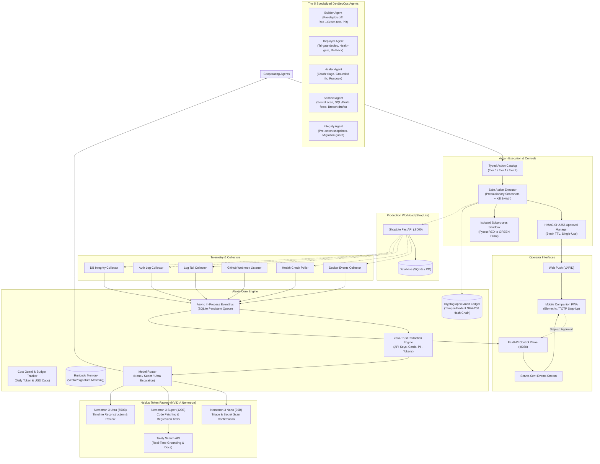
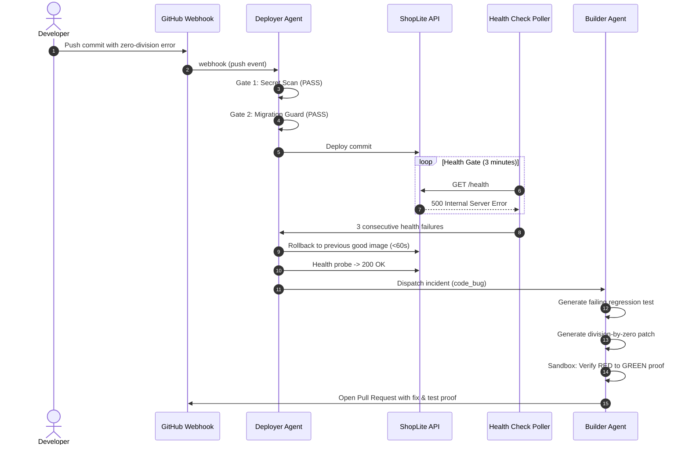
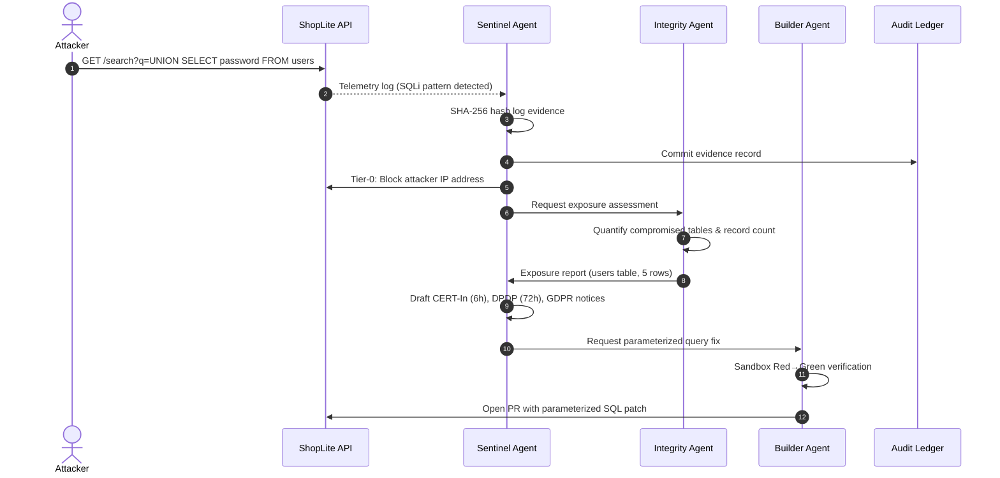

# Alexia Architecture Specification

This document details the internal design, multi-agent event loop, safety model, cryptographic audit ledger, and hardware/model routing of **Alexia — Autonomous DevSecOps Guardian**.

---

## 1. High-Level System Architecture

Alexia operates as an asynchronous, event-driven guardian running alongside production containerized workloads. It connects telemetry collectors, an in-process async EventBus, five specialized agents powered by **NVIDIA Nemotron models on Nebius Token Factory**, a typed safety catalog, and a mobile Progressive Web App (PWA).



---

## 2. Event-Driven Reactive Pipeline

Alexia does not poll statically; it reacts asynchronously through an append-only event stream:

1. **Collection:** Collectors (`alexia/collectors/`) poll or stream container state, HTTP health status, docker logs, git webhooks, and database query statistics.
2. **Ingestion:** Telemetry items are emitted onto the `EventBus` (`alexia/core/bus.py`).
3. **Redaction:** The `RedactionEngine` (`alexia/core/redact.py`) scrubs credentials (API tokens, private keys, credit cards verified via the Luhn algorithm, emails, phone numbers) before any string is processed by LLMs or saved in model logs.
4. **Dispatch:** The `Orchestrator` (`alexia/core/orchestrator.py`) passes redacted incident events to the designated agent.
5. **Execution:** Actions are validated against the `ActionCatalog` (`alexia/actions/catalog.py`). If safe (Tier 0), they execute immediately. If mutating (Tier 1), an HMAC-signed approval token is dispatched via Web Push to the operator's mobile PWA. Tier 2 actions are strictly rejected.
6. **Ledger Commit:** Every state transition and action output is recorded in the SHA-256 hash-chained `AuditLog` (`alexia/core/audit.py`).
7. **Stream Propagation:** Events are pushed over SSE (`/api/v1/events/stream`) to update the live UI in real time.

---

## 3. The 5 Specialized DevSecOps Agents

### 3.1 Builder Agent (`alexia/agents/builder.py`)
- **Role:** Autonomous Software Engineer & Fix Author.
- **Workflow:**
  1. **Pre-Deploy Review:** Evaluates git diffs for high-risk modifications (unhandled exceptions, hardcoded credentials, schema mismatches).
  2. **Regression Test Authoring:** When an incident occurs (e.g. `ZeroDivisionError`), Nemotron Super writes a reproduction test (`test_regression_*.py`).
  3. **Patch Generation:** Nemotron Super generates the minimal syntactic patch fixing the issue.
  4. **Sandbox Red-to-Green Proof:** Runs `pytest` inside `alexia/tools/sandbox.py`. Proves that the regression test **fails on unpatched code** (RED) and **passes with the patch applied** (GREEN).
  5. **Pull Request:** Authors a pull request via the GitHub REST API (`alexia/tools/github.py`) containing the patch, reproduction test, and proof logs.

### 3.2 Deployer Agent (`alexia/agents/deployer.py`)
- **Role:** Gatekeeper & Release Orchestrator.
- **Tri-Gate Pre-Deploy Verification:**
  - **Gate 1 (Sentinel Secret Scan):** Scans the incoming commit diff for API keys, high-entropy tokens, and passwords.
  - **Gate 2 (Integrity Migration Guard):** Dry-runs any SQL migration scripts against an ephemeral copy of the database to guarantee non-destructive execution.
  - **Gate 3 (Builder Risk Review):** Assesses diff for critical syntactic or runtime hazards.
- **Health-Gated Deployment:**
  - Upon deployment, monitors the `/health` endpoint for 3 minutes (probing every 15s).
  - If three consecutive checks fail or 5xx error rate spikes above 5%, triggers **automatic rollback in <60 seconds** to the previous known-good image.

### 3.3 Healer Agent (`alexia/agents/healer.py`)
- **Role:** Autonomous Site Reliability Engineer.
- **Workflow:**
  1. **Fast Triage:** Catches container exits, OOM kills, or disk-full events. Classifies category and severity using Nemotron Nano in <150ms.
  2. **Runbook Lookup:** Queries `RunbookMemory` for matching past incidents. If found with high confidence (>0.85), executes the verified resolution immediately.
  3. **Grounded Diagnosis:** If novel, searches error codes via `TavilySearchClient` (`alexia/tools/tavily.py`) and submits search snippets to Nemotron Super.
  4. **Recovery & Verification:** Restarts container, verifies healthy status, and commits the newly verified fix into `RunbookMemory`.

### 3.4 Sentinel Agent (`alexia/agents/sentinel.py`)
- **Role:** Threat Detection & Regulatory Compliance Lead.
- **Workflow:**
  1. **Secret Scanning:** Multi-pattern regex engine combined with Shannon entropy detection catches Stripe keys, GitHub tokens, AWS keys, and private certificates.
  2. **Threat Detection:** Detects brute-force authentication attacks (>5 failed attempts in 60s) and SQL injection attempts (`UNION SELECT`, `' OR '1'='1`).
  3. **Immediate Containment:** Issues Tier-0 IP block on the attacker address via reverse proxy / iptables.
  4. **Evidence Preservation:** Generates SHA-256 cryptographic hashes of raw access logs and query strings for non-repudiation.
  5. **Automated Regulatory Breach Reporting:**
     - **CERT-In (Directions 2022):** Formatted mandatory notice within the **6-hour statutory deadline**.
     - **DPDP Rules 2025 (India):** Formatted initial intimation and **72-hour detailed report** under Rule 7.
     - **GDPR (Article 33):** Supervisory authority notification with affected categories and mitigation steps.

### 3.5 Integrity Agent (`alexia/agents/integrity.py`)
- **Role:** Data Protection & Migration Guardian.
- **Guarantees:**
  - **Precautionary Snapshots:** Automatically triggers an atomic database snapshot before any Tier-1 mutating action executes (`alexia/tools/snapshots.py`).
  - **Migration Guard:** Executes migrations against an isolated throwaway database clone. Blocks migrations that drop active columns or tables without an explicit deprecation flag.
  - **Exposure Quantification:** In the event of an injection attack, queries database metadata to calculate exact counts of exposed records and compromised columns.

---

## 4. Safety Model & Action Catalog

Alexia enforces security strictly in code rather than relying on LLM self-policing:

```
+--------------------------------------------------------------------------------+
|                             SAFETY TIER SYSTEM                                 |
+--------------------------------------------------------------------------------+
|  Tier 0: Autonomous Safe (Immediate)                                           |
|  - restart_container                                                           |
|  - rollback_to_last_good_image                                                 |
|  - block_ip_temporarily                                                        |
|  - take_snapshot                                                               |
|  - run_integrity_check                                                         |
|  - open_pull_request                                                           |
+--------------------------------------------------------------------------------+
|  Tier 1: Human Approval Required (Single-Use HMAC Token, 5-Min TTL)            |
|  - restore_snapshot                                                            |
|  - rotate_secret                                                               |
|  - isolate_container_network                                                   |
|  - run_migration                                                               |
|  - merge_pull_request_and_deploy                                               |
+--------------------------------------------------------------------------------+
|  Tier 2: Forbidden Actions (Hard Rejected at Code Level)                       |
|  - arbitrary_shell_execution (e.g. rm -rf, raw bash)                           |
|  - delete_backup                                                               |
|  - drop_table (outside controlled migration guard)                             |
|  - open_firewall_port                                                          |
+--------------------------------------------------------------------------------+
```

### 4.1 Autonomy Kill Switch
- The operator can instantly freeze all autonomous actions by calling `pause_autonomy()`.
- When paused:
  - Detection and alerting continue unimpeded.
  - Any proposed Tier 0 or Tier 1 action is placed into a held approval state.
  - Resuming autonomy (`resume_autonomy()`) requires biometric/TOTP step-up authentication.

### 4.2 Cryptographic Approval Tokens
- Approval tokens are generated using HMAC-SHA256:
  $$\text{Token} = \text{HMAC-SHA256}(K, \text{action\_id} \parallel \text{timestamp} \parallel \text{nonce})$$
- Tokens expire in 5 minutes (300s).
- Every token is strictly single-use; upon consumption, it is marked as `used` in SQLite to prevent replay attacks.

---

## 5. Cryptographic Tamper-Evident Audit Ledger

Alexia maintains a verifiable SHA-256 hash chain stored in SQLite (`audit_log` table):

$$\text{hash}_0 = \text{SHA256}(\text{"0000000000000000000000000000000000000000000000000000000000000000"} \parallel T_0 \parallel E_0 \parallel A_0 \parallel D_0)$$
$$\text{hash}_i = \text{SHA256}(\text{hash}_{i-1} \parallel T_i \parallel E_i \parallel A_i \parallel D_i)$$

Where:
- $\text{hash}_{i-1}$: The previous entry's SHA-256 digest.
- $T_i$: ISO-8601 UTC timestamp.
- $E_i$: Event type (e.g., `incident_created`, `action_executed`, `snapshot_created`).
- $A_i$: Actor (e.g., `agent:healer`, `human:operator`).
- $D_i$: Canonical JSON-serialized payload with sorted keys.

### Tamper Verification
The verification algorithm traverses entries from index 0 to $N$:
1. Re-computes the SHA-256 hash using the previous entry's digest and row data.
2. Compares the re-computed hash with the recorded hash.
3. If any discrepancy is found, an alert is raised immediately, pinpointing the corrupted entry ID.

---

## 6. NVIDIA Nemotron Model Routing & Cost Guard

| Task Complexity | Model Name | Parameter Size | Cost / 1M In | Cost / 1M Out | Primary Purpose |
|---|---|---|---|---|---|
| **Low / Triage** | Nemotron 3 Nano | 30B | $0.06 | $0.24 | Log parsing, incident triage, regex validation, notification summaries. |
| **Medium / Code** | Nemotron 3 Super | 120B | $0.30 | $0.90 | Root cause analysis, code patching, regression test authoring, Tavily integration. |
| **High / Strategy** | Nemotron 3 Ultra | 550B | $1.00 | $3.00 | Breach forensic timeline synthesis, security policy reviews, migration risk analysis. |

### BudgetGuard & Offline Replay Fallback
- `BudgetGuard` tracks cumulative tokens and USD cost per 24-hour cycle.
- Default limit: **$5.00 / day** (configurable).
- When the daily budget is exhausted or when operating offline without live API credentials, Alexia smoothly switches to **Deterministic Simulation Mode**, ensuring automated evaluation suites and demo environments remain fully functional without runtime errors.

---

## 7. Sequence Diagrams

### 7.1 Scenario S1: Bad Deploy Health-Gate Rollback



### 7.2 Scenario S6: SQL Injection, Containment & Compliance


